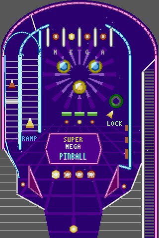
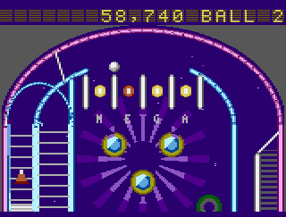
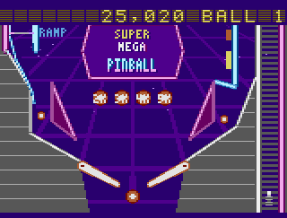

# Super Mega Pinball 7800

A scrolling pinball table for the **Atari 7800**, in the spirit of the great
Amiga and DOS pinball games, built for the **AstroCart**: its math unit does
the physics and two POKEYs play the music.

[](https://jasonfrowe.github.io/Super_Mega_Pinball_7800/)

**[▶ Play it in your browser](https://jasonfrowe.github.io/Super_Mega_Pinball_7800/)** (keyboard or gamepad), or on [jasonrowe.org](https://jasonrowe.org/Atari7800/pinball/). It runs in [js7800_astrocart](https://github.com/jasonfrowe/js7800_astrocart), an Atari 7800 emulator with the AstroCart's math unit and second POKEY.

| | | |
|---|---|---|
|  |  |  |
| The top: M-E-G-A lanes, pop bumpers, the wire ramp | Flippers, slingshots, inlanes | Three-ball multiball |

## Playing

| Input | |
|---|---|
| Left / Button 1 | left flipper (also moves the lit top lanes left) |
| Right / Button 2 | right flipper |
| Down (hold, let go) | pull the plunger back and shoot |
| Up | nudge the table (too often and it TILTs) |
| Fire | start a game |
| Reset | back to the title |

**The table, "MEGA"**

- **Skill shot**: one top lane flashes after each launch; plunge the ball
  into it for 50,000.
- **M-E-G-A lanes**: light all four for 25,000 and the bonus multiplier
  (2X up to 5X). The flippers move the lit lanes.
- **Pop bumpers**: 1,000.
- **Drop targets**: 2,500 each; all three light the **LOCK**.
- **The BLACK HOLE**: a lit lock locks a ball; the second lock starts
  **MULTIBALL** (100,000, three balls), and the **wire ramp** scores the
  **JACKPOT** (50,000, up 20,000 each time). Unlit, the hole is 5,000.
- **The wire ramp** (left): it climbs, turns over the top and comes down
  over the left orbit into the left inlane. 10,000, up 5,000 each time.
- **The orbit**: up the left lane, all the way round the top and down the
  right return lane: 20,000.
- **S-T-A-R standups**: 5,000 each; all three: 50,000.
- **Ball save** for the first 10 seconds of each ball; end-of-ball bonus
  times the multiplier.

## How it works

- **Physics on the AstroCart math unit** (`src/physics.asm`,
  [MATHUNIT.md](../../FPGA/Atari7800_AstroCart_V4/docs/MATHUNIT.md)). The
  table is ~100 colliders (one-sided walls, two-sided rails, posts,
  bumpers) from `tools/table.py`. Every test is one CORDIC write: the
  ball's offset from a collider, turned by minus its angle, gives the
  distance along and off it, and the straight distance and direction to
  its end, all at once. A hit turns the velocity into the surface's frame,
  bounces the normal part on the multiplier (elasticity, slingshot and
  bumper kicks) and turns it back. A grid lists the colliders near each
  32x32 cell, and a frame splits into up to four substeps by speed so the
  ball never tunnels.
- **Real flippers**: each is a rotating capsule. Its surface moves under
  the ball at (angular speed) x (lever), so shots off the tip are faster,
  and a ball can be cradled, caught, passed and shot from a dead stop.
  The right flipper is the left one mirrored.
- **2.5D**: balls carry a layer; the ramp's entrance lifts a ball onto it
  and its walls only exist there, so it crosses over the orbit lane.
- **Display** (`src/engine.asm`): 160A, a 16-line dot-matrix score display
  over a 209-line playfield that scrolls a line at a time over a 480-line
  table. The table's picture is drawn by `tools/table.py` from the same
  geometry and packed into MARIA direct-mode objects (up to two palettes
  per 4x16 cell, 23K of graphics). Map rows rotate through 16 display-list
  slots; lamps are objects whose palette the game flips (drop targets hide
  by moving off screen).
- **Sound** (`src/sound.asm`, `tools/music.py`): an original tune on two
  POKEYs ($0450 and $0440): 16-bit lead and bass on the first, a 16-bit
  arpeggio voice and drums on the second; effects on the TIA. The title,
  the game and multiball play it at three speeds.
- 48K, no bank switching: graphics at $4000-$8FFF, $A000, $C000, $E000;
  code in the $9000/$B000/$D000/$F000 DMA holes. Pure 6502 assembly (dasm).

## Building and running

Needs Python 3 and wasmtime (dasm and the 7800 signing tool are run from
`tools/7800basic`).

```sh
tools/build.sh      # table, sprites, music -> build/pinball.a78
tools/play.sh       # run it in the a7800 fork (-nomouse)
```

The .a78 header asks for POKEYs at $0450 and $0440 (cart type bits 6 and
10, v4 audio field 3) and the math unit ("ACM" at bytes 59-61). The a7800
fork's `cordic` branch has the math unit; the second POKEY at $0440 needs
its `a78_rom_p450_device` change (in the fork's working tree).

Testing headless: `tools/test.sh script.txt` (scripted input, snapshots,
memory peeks; see `tools/emu/play.lua`), `tools/shot.py` (put the ball
somewhere with a velocity and log it), `tools/soak.sh` (an autoplay bot),
`tools/pcprof.py` (where the CPU time goes). `build/table_geo.png` shows the
colliders, sensors and flipper sweep over the picture.

## License

GPL-3.0 (see `LICENSE`).
