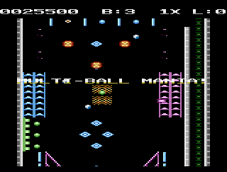

# Super Mega Pinball 7800: Ignition

A fast-paced, colorful arcade pinball game for the **Atari 7800 ProSystem**, inspired by *Pinball Dreams* on the Amiga 500.

Combines:
- **AtariGammaForce's 160A Smooth Vertical Scrolling Engine** (`src/asm/engine.asm`): 20-row (320-scanline) playfield scrolling smoothly both **up and down** at 1-scanline precision (60 Hz) beneath a fixed low-DMA Zone 0 LED scoreboard HUD, using all **8 hardware 160A 3-color palettes (25 simultaneous on-screen colors)**.
- **AstroCart FPGA MathUnit & CORDIC Co-Processor** (`$0420-$043F`, `src/asm/physics.asm`): Real-time 360-degree CORDIC radial bumper rebounds, position-sensitive CORDIC flipper shot angles, and hardware multiply/divide scoring and plunger physics.



## Controls

| Input | Action |
|---|---|
| **Joystick Down** (hold & release) | Pull back the spring plunger and release to launch the ball |
| **Joystick Left** or **Button 1** | Left Flipper |
| **Joystick Right** or **Button 2** | Right Flipper |
| **Console Reset** | Return to Attract / Title mode |

## Table Features

- **Spring-Loaded Shooter Lane & Orbital Arch**: Pull back `Down` on the joystick to compress the plunger spring and release to shoot the ball up into the top orbital arch.
- **Top Rollover Lanes (`I - G - N`)**: Light all three top lanes to score a **5,000-pt Skill Bonus** and advance the **Playfield Multiplier (`1X -> 2X -> 3X -> 5X`)**.
- **3 Turbo Pop Bumpers**: CORDIC-calculated radial rebounds with flashing bumper caps and dual-tone bell chimes.
- **Left "HYPER RAMP"**: Shoot the cyan ramp entrance at high speed to rocket up to the top orbital loop for a **10,000-pt Ramp Bonus**.
- **Right "WARP CHUTE" & Whirling Spinner**: High-speed magenta spinner that whirls and awards bonus points on every rotation tick.
- **3 Emerald Drop Targets (`M - E - G`) & Center "IGNITION CORE"**: Complete the drop target bank or hit the Ignition Core lock target to lock balls (`BALL 1 LOCKED!` -> `READY MULTI-BALL!`) and unleash **3-Ball Multi-Ball Mania** (`+25,000 Super Jackpot`)!
- **Left & Right Slingshot Kickers & Inlane Funnels**: Diagonal kickers and chrome guide rails above the flippers.

## Building & Running

```sh
./tools/build.sh          # Generates 160A assets & compiles build/pinball.a78
./tools/play.sh           # Runs build/pinball.a78 in the a7800 emulator (-nomouse)
```

## License

GPL-3.0 (see `LICENSE`).
